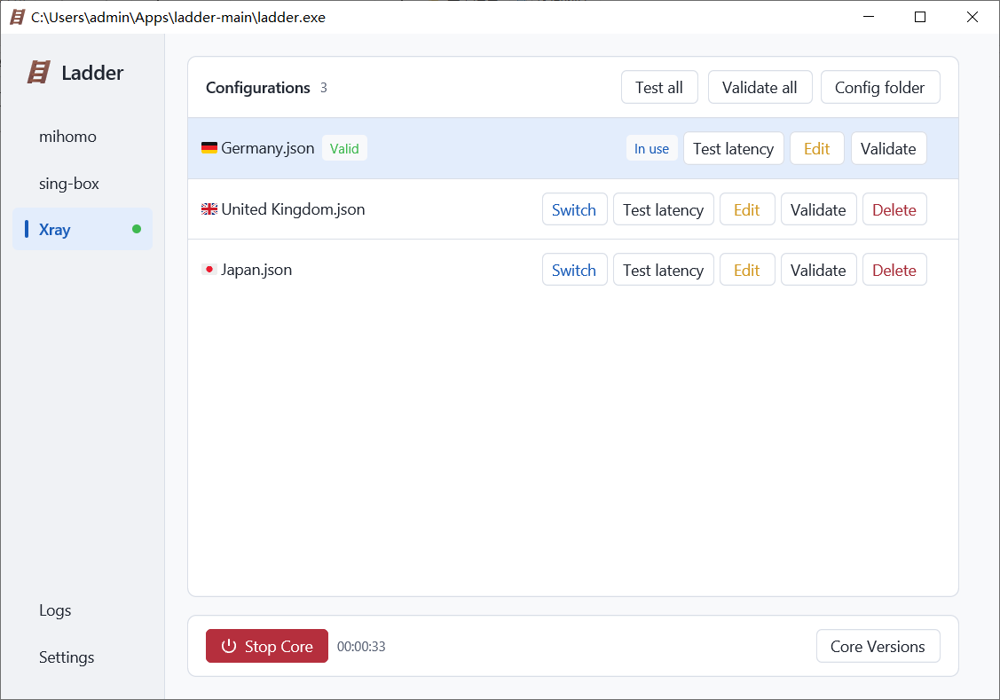

    
    <h2 align="center">Ladder</h2>
    

        A lightweight Windows launcher for mihomo, sing-box, and Xray.
    

    <strong>English</strong> | <a href="README.zh-CN.md">简体中文</a> | <a href="README.ru.md">Русский</a>

You maintain your core configurations; Ladder handles version management, configuration validation, and starting and stopping core processes. It is intended only for users who run their own proxy servers and want full control over their configurations.

**Importing share links is not supported. You must write your own complete configuration files.**

## Getting started

1. Download the portable package for your Windows architecture from [GitHub Releases](https://github.com/senzyo/ladder/releases/latest) and extract it.
2. Run `ladder.exe` and grant administrator privileges when prompted by Windows UAC.
3. Select a core, open “Core Versions”, and download the version you want. Ladder automatically selects the first version you install for each core. Later downloads keep your current selection.
4. Click “Config folder”, add your configuration files, then return to the list and click “Validate”.
5. If the configuration is valid, click “Start Core” to run it.

In Settings, use the language selector to switch between 简体中文, English, and Русский (`zh-Hans`, `en-US`, and `ru-RU`). By default, Ladder follows the system display language and falls back to English for unsupported languages. Selecting a language updates the interface and system tray immediately, and your choice is preserved after restarting.

If `VCRUNTIME140.dll` is missing, install the [Microsoft Visual C++ v14 Redistributable](https://learn.microsoft.com/en-us/cpp/windows/latest-supported-vc-redist) for the application's architecture: x64 for amd64, or ARM64 for arm64. When using a virtual machine or Windows Sandbox, install it inside that environment.

## Development

- [Development and testing](https://github.com/senzyo/ladder/blob/main/docs/development.md) (Chinese): modules, acceptance criteria, and safe testing constraints.
- [Building and releasing](https://github.com/senzyo/ladder/blob/main/docs/releasing.md) (Chinese): local scripts, GitHub Actions, and conventions for versions and release artifacts.
- [Official references for validation commands](https://github.com/senzyo/ladder/blob/main/docs/core-references.md) (Chinese).
