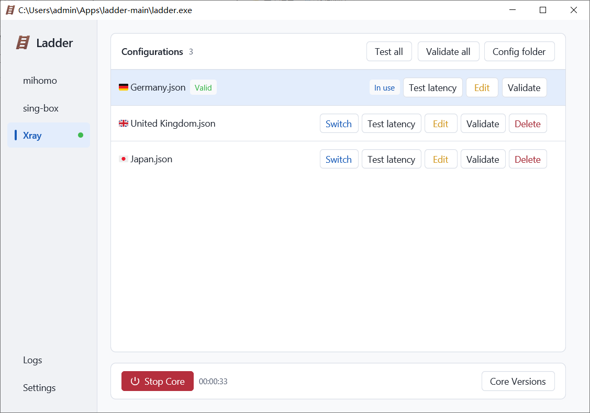

    
    <h2 align="center">Ladder</h2>
    

        Лёгкое приложение для запуска mihomo, sing-box и Xray в Windows.
    

    <a href="README.md">English</a> | <a href="README.zh-CN.md">简体中文</a> | <strong>Русский</strong>

Вы самостоятельно поддерживаете конфигурации ядер, а Ladder управляет их версиями, проверяет конфигурации, запускает и останавливает процессы. Приложение предназначено только для пользователей, которые самостоятельно настраивают свои прокси-серверы и хотят полностью контролировать конфигурацию.

**Обратите внимание: импорт ссылок для быстрого подключения не поддерживается. Необходимо самостоятельно написать полный файл конфигурации.**

## Начало работы

1. Скачайте портативный архив для архитектуры вашей Windows из [GitHub Releases](https://github.com/senzyo/ladder/releases/latest) и распакуйте его.
2. Запустите `ladder.exe` и предоставьте права администратора в запросе UAC Windows.
3. Выберите ядро, откройте «Версии ядра», скачайте нужную версию и переключитесь на неё.
4. Нажмите «Папка конфигураций», поместите туда свой файл конфигурации, затем вернитесь к списку и нажмите «Проверить».
5. Если конфигурация корректна, нажмите «Запустить ядро».

В настройках можно выбрать 简体中文, English или Русский (`zh-Hans`, `en-US`, `ru-RU`). По умолчанию используется язык интерфейса системы, а если он не поддерживается — английский. При ручном выборе язык интерфейса и меню в системном трее меняется сразу, а выбранное значение сохраняется после перезапуска.

Если появляется сообщение об отсутствии `VCRUNTIME140.dll`, установите [распространяемый пакет Microsoft Visual C++ v14](https://learn.microsoft.com/ru-ru/cpp/windows/latest-supported-vc-redist) для архитектуры приложения: x64 для amd64 или ARM64 для arm64. При работе в виртуальной машине или песочнице пакет необходимо установить внутри неё.

## Разработка

- [Разработка и тестирование](https://github.com/senzyo/ladder/blob/main/docs/development.md) (на китайском): модули, объём приёмочных проверок и ограничения для безопасного тестирования.
- [Сборка и выпуск](https://github.com/senzyo/ladder/blob/main/docs/releasing.md) (на китайском): локальные скрипты, GitHub Actions, правила версионирования и соглашения об артефактах сборки.
- [Официальные источники команд проверки конфигураций](https://github.com/senzyo/ladder/blob/main/docs/core-references.md) (на китайском).
