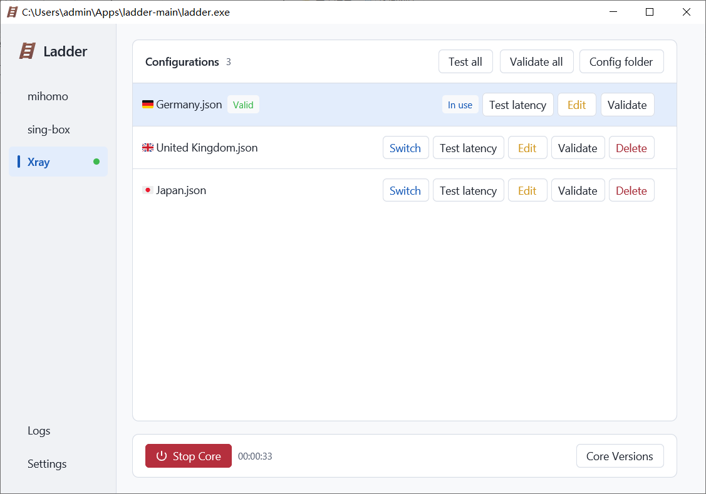

    
    <h2 align="center">Ladder</h2>
    

        一个 Windows 上的 mihomo、sing-box 和 Xray 轻量启动器。
    

    <a href="README.md">English</a> | <strong>简体中文</strong> | <a href="README.ru.md">Русский</a>

用户维护核心配置, Ladder 负责版本管理、配置验证、进程启停等操作。仅适用于自己搭建节点、并希望掌控配置全部细节的用户。

**注意, 不支持导入分享链接来简单地使用, 你必须写完整的配置文件。**

## 开始使用

1. 从 [GitHub Releases](https://github.com/senzyo/ladder/releases/latest) 下载与你的 Windows 架构匹配的便携包并解压。
2. 运行 `ladder.exe`, 按 Windows UAC 提示授予管理员权限。
3. 选择核心, 进入“管理核心版本”下载所需版本。首次安装后会自动选用该版本, 后续下载会保留当前选择。
4. 点击“打开配置目录”, 放入自己的配置文件, 返回列表点击“验证”。
5. 如果配置合法, 可点击“启动核心”来运行。

设置中可切换简体中文、English 和 Русский (`zh-Hans`、`en-US`、`ru-RU`)。默认匹配系统显示语言, 不支持的语言使用英语；手动选择后立即更新界面和托盘, 并在重启后保留。

如果提示缺少 `VCRUNTIME140.dll`, 安装与程序架构对应的 [Microsoft Visual C++ v14 Redistributable](https://learn.microsoft.com/zh-cn/cpp/windows/latest-supported-vc-redist)。amd64 选择 x64, arm64 选择 ARM64；虚拟机和沙盒需在其内部安装。

## 开发

- [开发与测试说明](https://github.com/senzyo/ladder/blob/main/docs/development.md): 模块、验收范围与安全测试约束。
- [构建和发布](https://github.com/senzyo/ladder/blob/main/docs/releasing.md): 本地脚本、GitHub Actions、版本与产物约定。
- [官方验证命令依据](https://github.com/senzyo/ladder/blob/main/docs/core-references.md)。
